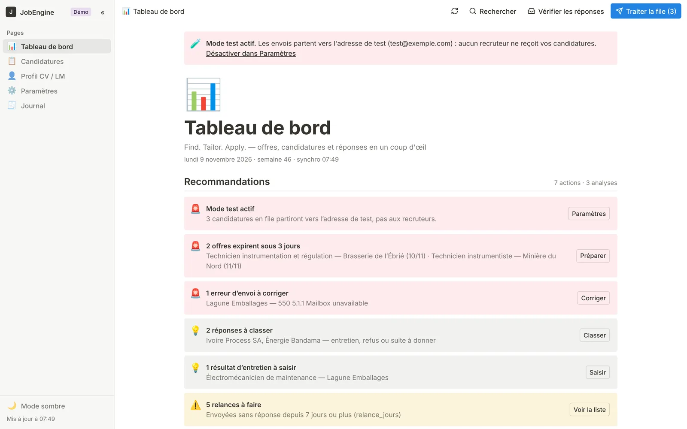
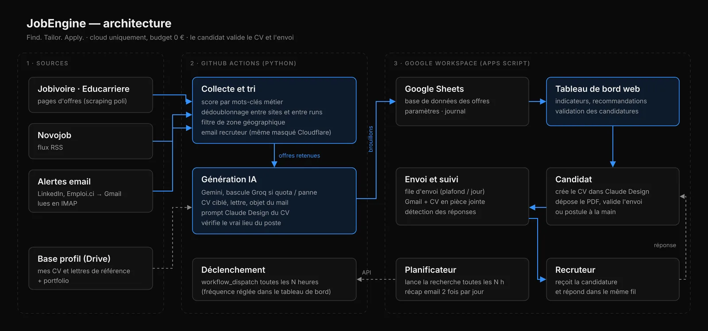
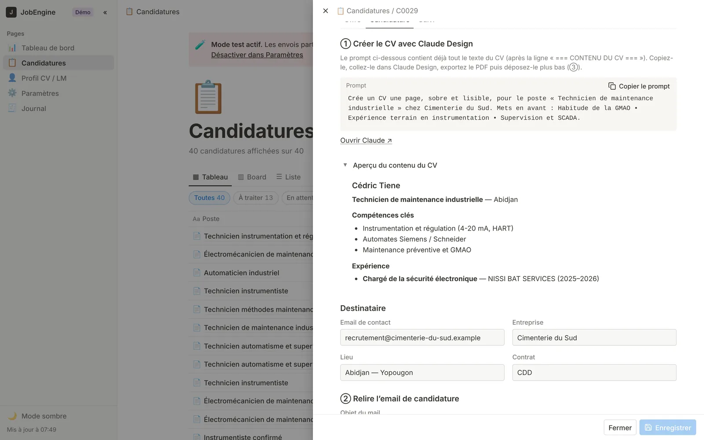

# JobEngine

**Find. Tailor. Apply.**

JobEngine automatise la partie répétitive d'une recherche d'emploi. Il lit les offres publiées sur plusieurs sites et dans les alertes email, garde celles qui correspondent au métier et à la zone recherchés, puis fait préparer par une IA un CV ciblé et une lettre pour chacune. Un tableau de bord web permet de valider, d'envoyer et de suivre les candidatures.

Tout tourne dans le cloud, sur des services gratuits : GitHub Actions, Google Sheets, Google Apps Script, Gmail et des API d'IA en offre gratuite. Aucun serveur, aucun abonnement.

> Les captures utilisent des données de démonstration : entreprises et adresses fictives.

## Ce que fait JobEngine

| Étape | Où | Rôle |
|---|---|---|
| 1. Collecte | GitHub Actions, `src/sourcing` | Lit les sites d'offres, un flux RSS et les alertes email reçues dans Gmail (LinkedIn, sites d'emploi) |
| 2. Tri | GitHub Actions, `src/sourcing` | Score par mots-clés métier, dédoublonnage entre sites et entre passages, filtre de zone, recherche de l'email du recruteur |
| 3. Préparation | GitHub Actions, `src/generation` | Gemini (bascule sur Groq) prépare le contenu du CV, la lettre, l'objet du mail et un prompt de mise en page, à partir des CV de référence du candidat |
| 4. Validation | Apps Script, `apps-script/` | Le candidat crée le CV, dépose le PDF et valide depuis le tableau de bord |
| 5. Envoi | Apps Script, toutes les 10 min | File d'envoi Gmail avec CV en pièce jointe, plafond par jour, mode test |
| 6. Suivi | Apps Script, toutes les heures | Détection des réponses dans le fil Gmail, récapitulatif email 2 fois par jour |

## Principes

- **Le candidat garde la main.** Rien ne part sans un CV déposé par lui. Un mode test redirige tous les envois vers sa propre adresse.
- **L'IA n'invente rien.** Intitulés de poste, entreprises, dates et diplômes sont repris tels quels des CV de référence ; les écarts avec l'offre sont notés.
- **Tout est tracé.** Chaque collecte, préparation et envoi est inscrit dans l'onglet *Journal*.

## Installation

### 1. Google Sheets et Apps Script
1. Créez un Google Sheets vide, puis ouvrez **Extensions → Apps Script**.
2. Copiez `apps-script/Code.gs` et `apps-script/Index.html` dans le projet.
3. Exécutez `setup` (onglets, paramètres), puis `setupTriggers` (déclencheurs).
4. **Déployer → Nouveau déploiement → Application Web** : c'est le tableau de bord.
5. Dans **Paramètres du projet → Propriétés du script**, ajoutez :
   - `GITHUB_TOKEN` : jeton GitHub (accès *Actions : lecture et écriture* sur ce dépôt) ;
   - `GITHUB_REPO` : `propriétaire/dépôt`, si différent de la valeur par défaut.

### 2. Base profil sur Google Drive
1. Créez deux dossiers : CV de référence et lettres de référence (PDF, DOCX ou Google Docs).
2. Partagez-les, ainsi que le Google Sheets, avec l'adresse du compte de service Google.
3. Reportez leurs identifiants dans `config.yaml` (`generation.dossier_cv`, `generation.dossier_lm`).

### 3. Secrets GitHub (Settings → Secrets and variables → Actions)
| Secret | Rôle |
|---|---|
| `GOOGLE_SERVICE_ACCOUNT_JSON` | Clé JSON du compte de service (Sheets et Drive) |
| `SHEET_ID` | Identifiant du Google Sheets |
| `GEMINI_API_KEY` | Clé API Gemini (Google AI Studio, offre gratuite) |
| `GROQ_API_KEY` | Clé API Groq, modèle de secours (facultatif) |
| `GMAIL_USER`, `GMAIL_APP_PASSWORD` | Lecture des alertes email en IMAP, avec un mot de passe d'application (facultatif) |

Aucun secret n'est stocké dans le code.

### 4. Adapter à votre recherche (`config.yaml`)
- `profil` : nom du candidat, domaine, pays, nom du CV de référence pour la mise en page.
- `scoring.keywords` : mots-clés du métier et leurs poids ; `threshold` : score minimum.
- `lieux_cibles` : zone géographique (modifiable aussi dans le tableau de bord, paramètre `zone_recherche`).
- `sources` : sites, flux RSS et dossier Gmail des alertes.

La fréquence de recherche, le plafond d'envois, le mode test et les heures du récapitulatif se règlent dans l'onglet **Paramètres** du tableau de bord.

## Stack

Python (httpx, BeautifulSoup, feedparser, imap-tools, gspread, tenacity) · GitHub Actions · Google Apps Script · Google Sheets · Gmail · Google Drive · Gemini · Groq · JavaScript · Chart.js

## Licence

MIT
