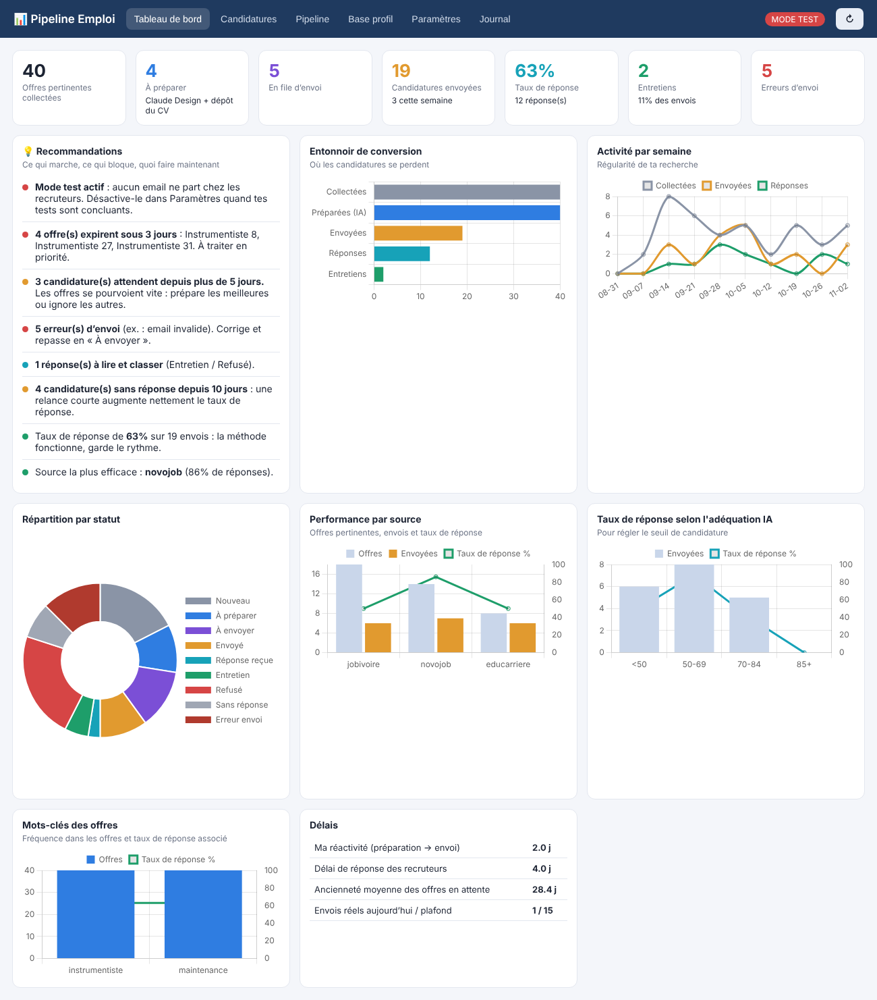

# job-sourcing-ci — Pipeline de candidatures automatisé (Côte d'Ivoire)

| Module | Où | Rôle |
|---|---|---|
| 1 Sourcing | GitHub Actions (`src/sourcing`) | Jobivoire, Educarriere, Novojob RSS, alertes email → Sheets (`Nouveau`) |
| 2 Génération | GitHub Actions (`src/generation`) | Base_Profil (Drive) + Gemini/Groq → contenu CV, prompt Claude Design, objet, lettre (`À préparer`) |
| 3 Validation | Apps Script Web App (`apps-script/`) | Tableau de bord : copier le prompt, déposer le CV PDF, relire, valider (`À envoyer`) |
| 4 Envoi | Apps Script (toutes les 10 min) | Contrôles + Gmail (lettre + CV) → `Envoyé` |
| 5 Suivi | Apps Script (toutes les heures) | Détection des réponses → `Entretien` / `Refusé` / `Réponse reçue` |
| Alertes | Apps Script (2×/jour) | Email récapitulatif uniquement s'il y a du travail |



---
## Historique : Module 1 — Sourcing des offres

Pipeline de recherche d'emploi automatisé — postes **instrumentiste / automaticien / maintenance industrielle**.
Budget : **0 €**. Exécution : **cloud (GitHub Actions)**, indépendante du PC.

## Architecture retenue (Variante B)

| Couche | Brique |
|---|---|
| Déclenchement | GitHub Actions `schedule` + `workflow_dispatch` (option : cron-job.org) |
| Collecte HTML | `httpx` + en-têtes navigateur → `curl_cffi` si protection → Playwright en dernier recours |
| Flux RSS | `feedparser` |
| Alertes email (LinkedIn, sites bloqués) | `imap-tools` (Gmail + mot de passe d'application) |
| Parsing | `beautifulsoup4` / `selectolax` |
| Format commun | `pydantic` (modèle `Offre`) |
| Dédoublonnage | hash `entreprise+poste` + `rapidfuzz` |
| Stockage | `gspread` + compte de service Google → Google Sheets |
| Robustesse | `tenacity` (retries), `try/except` par source, `timeout-minutes` |
| Supervision | Alerte Telegram (échec / source muette 2 runs de suite) |
| Secrets | GitHub Secrets |

### Solutions aux limites

| Limite | Solution |
|---|---|
| IP GitHub bloquée | Niveaux : en-têtes réalistes → délais → `curl_cffi` → alertes email → relais Apps Script → Playwright |
| Quota 2 000 min/mois (repo privé) | Cache pip, pas de Playwright par défaut, requêtes conditionnelles, `timeout-minutes` (~240 min/mois estimées) |
| Cron imprécis | Minutes décalées (`17 */6 * * *`) + `workflow_dispatch` ; cron-job.org si précision requise |
| Règle des 60 jours | Ne concerne que les repos **publics** → repo **privé** |
| Sélecteurs cassés | Sélecteurs dans `config.yaml`, alerte si 0 offre 2 runs de suite, HTML brut en artifact |
| Runner éphémère | Colonne `ID` du Sheets = état de dédoublonnage |
| Quota Sheets | Une écriture groupée (`append_rows`) par run |
| Légal / politesse | Pages publiques uniquement, robots.txt respecté, 3–5 s entre requêtes |

## Étape actuelle : diagnostic des sources

Teste chaque site **depuis les serveurs GitHub** sur 3 niveaux d'accès et produit un rapport.

### Lancer le test
1. Créer un repo **privé** sur GitHub (ex. `job-sourcing-ci`).
2. Pousser ce dossier :
   ```bash
   git init && git add . && git commit -m "Diagnostic des sources"
   git branch -M main
   git remote add origin https://github.com/<ton-compte>/job-sourcing-ci.git
   git push -u origin main
   ```
3. GitHub → onglet **Actions** → *Diagnostic des sources CI* → **Run workflow**.
4. Après ~2 min : le rapport s'affiche dans le **résumé du run** ; le HTML brut est dans l'artifact `diagnostic-report`.

### Lire le verdict
| Verdict | Signification | Suite |
|---|---|---|
| `OK (python_default)` | Accès libre | httpx simple |
| `OK (browser_headers)` | Bloque les robots naïfs | En-têtes navigateur |
| `OK (curl_cffi_chrome)` | Protection TLS / Cloudflare | `curl_cffi` |
| `ACCESSIBLE MAIS 0 OFFRE` | Rendu JavaScript ou motif d'URL à corriger | Inspecter le HTML, puis Playwright / API interne |
| `BLOQUÉ depuis GitHub` | IP datacenter refusée | Alertes email ou relais Apps Script |

### Ajouter une source
Ajouter un bloc dans `diagnostic/sources.yaml` (`id`, `name`, `url`, `offer_link_regex`, `rss_candidates`).
